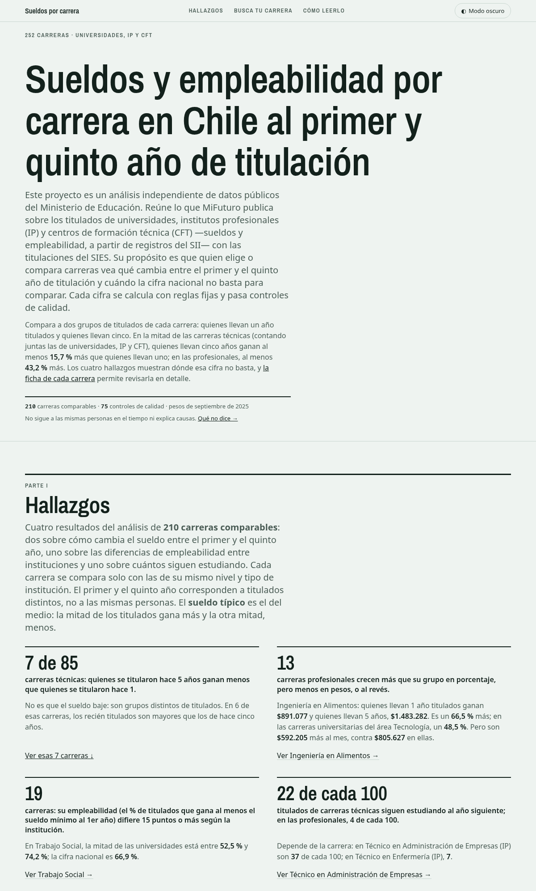

# Radiografía de las carreras y sueldos en Chile

## Introducción

Análisis independiente de datos públicos del Ministerio de Educación (MiFuturo y SIES) sobre <!-- DATO:pares_total -->252<!-- /DATO --> carreras de universidades, institutos profesionales (IP) y centros de formación técnica (CFT): cuánto ganan y cuántos trabajan sus titulados al primer y al quinto año de titularse.

La cifra nacional de una carrera junta a muchas instituciones y a titulados con sueldos muy distintos, así que no basta para comparar: puede esconder grandes diferencias entre instituciones, y un crecimiento alto en porcentaje puede ser bajo en pesos. Este proyecto compara cada carrera con otras parecidas de su mismo nivel y tipo de institución, y avisa cuándo la cifra nacional engaña.

- **Web:** [joaomunoz.github.io/carreras-sueldos-chile](https://joaomunoz.github.io/carreras-sueldos-chile/)
- **Sin conexión:** [`docs/index.html`](docs/index.html), un solo archivo (≈ <!-- DATO:peso_web -->1,4 MB<!-- /DATO -->) con los datos incluidos; se abre con doble clic.
- **Resultados principales:** en la sección [Resultados](#resultados).



---

## Objetivo

**Preguntas que responde**

- ¿Cuánto gana el titulado típico de cada carrera al primer y al quinto año de titularse, y cuánto más gana quien lleva cinco años que quien lleva uno?
- ¿Cómo le va a una carrera frente a las carreras parecidas de su mismo nivel y tipo de institución?
- ¿Cuándo la cifra nacional describe mal a las instituciones que imparten una carrera?
- ¿Qué cambia si el crecimiento del sueldo se mide en porcentaje o en pesos?

**Qué entrega**

- Una web en tres partes: hallazgos, una ficha por carrera con buscador y una guía «Cómo leerlo» con definiciones, límites y controles.
- Una base PostgreSQL que se reconstruye con un solo comando desde los datos públicos.
- Los datos publicados (`docs/datos.json`), armados en SQL, y controles de calidad que detienen la construcción si una cifra deja de respaldar lo que se publica.

---

## Alcances y limitaciones

**Qué cubre**

- <!-- DATO:pares_total -->252<!-- /DATO --> carreras de pregrado por tipo de institución (universidades, IP y CFT), técnicas y profesionales. <!-- DATO:pares_comparables -->210<!-- /DATO --> son comparables (las imparten al menos <!-- DATO:min_inst_oferta -->3<!-- /DATO --> instituciones); las otras <!-- DATO:pares_no_representativos -->42<!-- /DATO --> se muestran sin compararlas, porque su cifra nacional es la de una o dos instituciones.
- Sueldos y empleabilidad de MiFuturo, a partir de los registros del Servicio de Impuestos Internos (SII): ingresos <!-- DATO:anios_ingreso -->2022–2024<!-- /DATO -->, en pesos de <!-- DATO:pesos_de -->septiembre de 2025<!-- /DATO -->.
- Titulaciones del Servicio de Información de Educación Superior (SIES), <!-- DATO:anios_sies -->2017–2025<!-- /DATO -->: pesan a cada carrera y dan el contexto de quiénes la estudian (sexo, edad, oferta).
- Cifras nacionales por carrera y tipo de institución; por institución, solo lo que MiFuturo publica (empleabilidad, continuidad de estudios y rango de ingreso al 4° año).

**Qué no dice**

- **Es una comparación transversal, no longitudinal:** el sueldo típico del 1er año sale de los titulados <!-- DATO:cohorte_p1 -->2023<!-- /DATO --> y el del 5° año, de los titulados <!-- DATO:cohorte_p5 -->2019<!-- /DATO -->. Son grupos distintos, no las mismas personas en el tiempo.
- **No prueba causas** ni dice qué carrera elegir: describe diferencias entre grupos de titulados.
- **Cobertura:** MiFuturo cubre el <!-- DATO:cobertura_1er -->90,5 %<!-- /DATO --> de los titulados recientes y el <!-- DATO:cobertura_5to -->84,5 %<!-- /DATO --> de los de hace cinco años. Faltan programas chicos y programas cerrados.
- **Solo ingresos formales:** cuenta a quienes ganan al menos el sueldo mínimo con registro en el SII.
- **Sin desagregación:** no hay datos de ingresos por sexo, edad ni región.
- **Años atípicos:** el ingreso promedio de varios años incluye titulados de <!-- DATO:anios_pandemia -->2020–2021<!-- /DATO --> (pandemia), y en <!-- DATO:cohortes_atipicas -->15<!-- /DATO --> carreras (<!-- DATO:cohortes_atipicas_salud -->6<!-- /DATO --> de salud) los titulados <!-- DATO:cohorte_p1 -->2023<!-- /DATO --> tuvieron una empleabilidad atípica. La web lo marca en cada ficha.

La lista completa, con sus cifras, está en la sección «Qué no dice este análisis» de la web.

---

## Metodología

**Fuentes.** [MiFuturo](https://www.mifuturo.cl): Buscador de Empleabilidad e Ingresos (por institución) y Buscador de Estadísticas por Carrera (nacional por carrera y tipo de institución), con sus metodologías 2025–2026. SIES: [base de datos de titulados](https://www.mifuturo.cl/bases-de-datos-titulados/) 2007–2025 (versión del 27-05-2026, con su [glosario](https://www.mifuturo.cl/wp-content/uploads/2026/05/GLOSARIO_DE_TITULADO_2007_2025_E.pdf)). Ambas son del Ministerio de Educación de Chile.

**Proceso.** Tres scrapers descargan y validan las fuentes → los CSV procesados se cargan en PostgreSQL en cuatro capas: `raw` (copia fiel), `modelo` (relacional, con PK, FK y `CHECK`), `analytics` (métricas) y `qa` (controles), todo en **una sola transacción** → SQL arma `docs/datos.json` → `construir.py` lo incrusta en una web de un solo archivo.

**Reglas de comparación**

- **El promedio y los percentiles nunca se combinan.** El promedio de cada año junta tres cohortes (1er año: titulados <!-- DATO:cohortes_media_1 -->2021–2023<!-- /DATO -->; 5° año: <!-- DATO:cohortes_media_5 -->2017–2019<!-- /DATO -->); los percentiles usan una sola (titulados <!-- DATO:cohorte_p1 -->2023<!-- /DATO --> y <!-- DATO:cohorte_p5 -->2019<!-- /DATO -->, con ingresos <!-- DATO:ingreso_percentiles -->2024<!-- /DATO -->). Son poblaciones distintas.
- **Sueldo típico = mediana (P50):** la mitad gana menos. El promedio lo suben los sueldos más altos.
- **Técnicas y profesionales nunca se mezclan en una comparación,** ni los tipos de institución en un grupo de referencia.
- **Comparable = la imparten al menos <!-- DATO:min_inst_oferta -->3<!-- /DATO --> instituciones** con titulados en ambos períodos. Con menos, la «cifra nacional» es en realidad la de una o dos instituciones.
- **El grupo de cada carrera es su área en MiFuturo, no la clasificación internacional CINE:** quien busca una carrera piensa por interés y ve esa clasificación en MiFuturo; la CINE separaba carreras afines, como Telecomunicaciones e Informática. Si su área tiene menos de <!-- DATO:min_pares_celda -->5<!-- /DATO --> carreras comparables, o una sola carrera pesa más del <!-- DATO:max_peso_dominante -->50 %<!-- /DATO --> del grupo (su mediana sería el valor de esa carrera), se compara con todas las de su nivel y tipo de institución.
- **Carrera del medio = mediana del grupo, ponderada por titulados** de ambos períodos y sin interpolar, así que siempre es una carrera real. Una diferencia de hasta ±<!-- DATO:margen_tipico_pp -->2<!-- /DATO --> pp (puntos porcentuales) o ±<!-- DATO:margen_tipico_pesos -->$20.000<!-- /DATO --> con ella se cuenta como empate.
- **Derecho se mide con titulados de un año antes,** como lo publica MiFuturo: el título de abogado lo entrega la Corte Suprema meses después de terminar la carrera. La misma regla se aplica a las cifras del SIES con un solo parámetro (`corrimiento_derecho`).
- **Cada institución se compara con la institución del medio de su carrera, no con la cifra nacional.** La cifra nacional queda <!-- BRECHA:INICIO -->+1,7 puntos de empleabilidad y +6,2 % en el rango de ingreso al 4° año<!-- BRECHA:FIN --> sobre las instituciones publicadas, porque describe una población más amplia. Se habla de **cifra nacional engañosa** cuando la empleabilidad del rango del medio de las instituciones (la mitad central) abarca <!-- DATO:min_iqr_enganoso -->15<!-- /DATO --> puntos o más.

**Controles de calidad.** <!-- CONTROLES:INICIO -->**81 controles de calidad**: 78 hacen fallar el build y 3 no aplican por diseño (documentados en la web)<!-- CONTROLES:FIN -->. Si uno falla, el exportador se niega a escribir los datos y la web no se puede regenerar. Reconstruir la base da el mismo archivo, con el mismo SHA-256, y ninguna cifra de la web está escrita a mano: textos, umbrales y ejemplos se calculan desde los datos, y los ejemplos se eligen por una regla.

<details>
<summary>Qué verifican los controles</summary>

- Que las columnas cargadas coincidan con el contrato de cada scraper.
- Que cada cohorte usada exista en el SIES.
- Que cada punto de las series de MiFuturo corresponda a la cohorte declarada: con ella, el error frente a la propia fuente es mínimo; corrida un año, se multiplica.
- Que los cuantiles ponderados coincidan con un cálculo independiente.
- Que cada hallazgo se calcule sobre el grupo que nombra su frase, y que la carrera y la institución del medio sean reales.

</details>

<details>
<summary>Modelo de datos</summary>

[Diagrama ER](src/BD/diagrama_modelo.md) (generado desde el catálogo de la base) · [diccionario de datos](src/BD/diccionario_datos.md).

</details>

---

## Resultados

*Este bloque lo genera `make web` desde `docs/datos.json`: son las mismas cifras de la web, calculadas en SQL con controles de calidad.*

<!-- HALLAZGOS:INICIO · generado por src/Web/construir.py desde docs/datos.json; no editar a mano -->
1. **Al quinto año no siempre se gana más.** En la mitad de las carreras técnicas, quienes llevan cinco años titulados ganan al menos 15,7 % más que quienes llevan uno; en las profesionales, al menos 43,2 % más. Pero en 7 de las 85 técnicas ganan menos, y en ninguna de las 125 profesionales. En 6 de esas 7, quienes se titularon hace poco son mucho mayores: no es que caigan los sueldos.
2. **Un crecimiento mayor en porcentaje puede ser menor en pesos.** 13 carreras profesionales (ninguna técnica) cambian de cuadrante según se mida el crecimiento en porcentaje o en pesos. En Ingeniería en Alimentos (Universidad), quienes llevan cinco años titulados ganan 66,5 % más que quienes llevan uno, pero son +$592.205, frente a +$805.627 de la carrera del medio de su grupo.
3. **La cifra nacional esconde diferencias entre instituciones.** En 19 carreras, la empleabilidad varía 15 puntos o más entre las instituciones del rango del medio. En Trabajo Social (Universidad), ese rango va de 52,5 % a 74,2 %, con una cifra nacional de 66,9 %.
4. **Seguir estudiando es cosa de las carreras técnicas.** Al año siguiente de titularse sigue estudiando el 21,7 % de los titulados de carreras técnicas y el 4,2 % de los de carreras profesionales. Depende de la carrera: 37,4 % en Técnico en Administración de Empresas (IP) y 6,8 % en Técnico en Enfermería (IP).

<details>
<summary>Precisiones de los hallazgos</summary>

- **Al quinto año no siempre se gana más:** compara el sueldo típico (la mediana o P50: la mitad gana menos) y da la mediana de las carreras de cada nivel, con los tipos de institución juntos. «Ganan menos» es más de 2 % menos; una diferencia menor se cuenta como empate. En esas 6 carreras, los de 30 años o más son el 32,3 % de los titulados de hace cinco años y el 55,6 % de los recientes (mediana de las 6).
- **Porcentaje y pesos:** no se cuentan las carreras que quedan a ±2 pp (puntos porcentuales) o ±$20.000 de la carrera del medio de su grupo. La carrera del medio es la mediana del grupo, ponderada por titulados.
- **Diferencias entre instituciones:** el rango del medio es la mitad central de las instituciones de la carrera, sin el cuarto más alto ni el cuarto más bajo (Trabajo Social: 32 instituciones).
- **Seguir estudiando:** promedio ponderado por titulados. No explica las diferencias de empleabilidad entre instituciones de una misma carrera.

</details>
<!-- HALLAZGOS:FIN -->

---

## Conclusión

La cifra nacional de una carrera es un punto de partida, no una respuesta: puede describir mal a las instituciones que la imparten, y lo que crece mucho en porcentaje puede crecer poco en pesos. Comparar con carreras parecidas, separar al titulado típico de los sueldos más altos y decir explícitamente qué no muestran los datos cambia la lectura de varias carreras. Hacerlo de forma abierta, con el código, los datos y las reglas a la vista, y con controles que detienen la publicación si una cifra deja de calzar, permite que cualquiera revise cada número.

---

## Anexo técnico: reproducibilidad y estructura del repositorio

**Requisitos:** PostgreSQL 15 o superior (usa `COPY … HEADER MATCH`; probado con 18.4), Python 3 (probado con 3.13) y `make`.

```bash
pip install -r requirements.txt

# Base vacía y conexión sin contraseña (autenticación peer); sin credenciales en el código.
createdb carreras_sueldos
export PGDATABASE=carreras_sueldos

make todo        # base de datos → docs/datos.json → docs/index.html  (≈ 50 s)
```

<details>
<summary>Cada paso de <code>make</code> por separado</summary>

- `make base` — `src/BD/build.py`: crea `raw`, `modelo`, `analytics` y `qa`, carga los CSV y corre los controles, todo en una transacción.
- `make datos` — `src/Analisis/exportar.py`: escribe `docs/datos.json` (no exporta si algún control falla).
- `make web` — `src/Web/construir.py`: arma `docs/index.html` con todo incluido (no necesita la base) y regenera en este README los resultados, el conteo de controles, la brecha de la cifra nacional y las cifras marcadas.

</details>

<details>
<summary>Rehacer los CSV desde las fuentes</summary>

Los CSV procesados están versionados en `src/Scrapers/*/Salida/`, así que no hace falta descargar nada. Para rehacerlos:

```bash
cd src/Scrapers
python3 Empleabilidad/obtener.py && python3 Empleabilidad/procesar.py
python3 Estadisticas/obtener.py  && python3 Estadisticas/procesar.py
python3 Titulados/obtener.py     && python3 Titulados/procesar.py    # descarga el Excel del SIES (≈ 39 MB)
```

`Titulados/obtener.py` busca en la página del SIES el enlace vigente al Excel, cuyo nombre cambia con cada versión.

</details>

**Estructura**

```
src/
├── Scrapers/          obtener.py → Entrada/ (crudo) · procesar.py → Salida/ (CSV) · esquema.py (contrato)
│   ├── Empleabilidad/   MiFuturo, por institución
│   ├── Estadisticas/    MiFuturo, nacional por carrera y tipo de institución
│   └── Titulados/       SIES, titulaciones por programa y año
├── BD/                el modelo: DDL, carga, controles, build.py, diagrama y diccionario
├── Analisis/
│   ├── sql/analytics/   las métricas (par, brecha, referencias, dispersión, contexto, hallazgos, exportación)
│   └── exportar.py
└── Web/               plantilla, estilos, app.js y construir.py
docs/                  index.html (la web), datos.json y captura.png
```

La web es HTML, CSS, JavaScript y SVG sin librerías: modo claro y oscuro, usable con teclado y lector de pantalla, sin desplazamiento horizontal a 320 px y con contraste ≥ 4,5:1 en todo el texto.

**Licencias y autoría**

- Datos: rigen las condiciones de uso de MiFuturo y del SIES; este repositorio no los relicencia.
- Fuente tipográfica: Archivo Narrow (SIL Open Font License 1.1, ver `src/Web/fuentes/`).
- Código: licencia [MIT](LICENSE).
- Autoría: análisis de [Joao Muñoz](https://joaomunoz.github.io).
