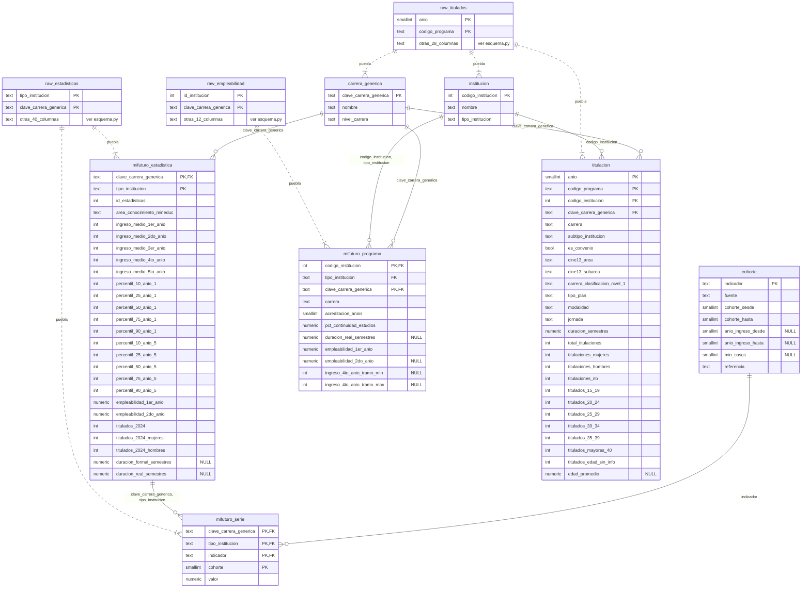

# Diagrama ER — base `carreras_sueldos`

> Generado desde el catálogo de PostgreSQL por `src/BD/diagrama.py`; no editar a mano.
> Regenerar con `python3 src/BD/diagrama.py` tras cambiar `src/BD/01_raw.sql` o `src/BD/02_modelo.sql`.

Lectura: línea sólida = FK (una fila de la tabla referida, cero o muchas que la referencian),
rotulada con sus columnas · línea punteada = la tabla `raw` desde la que se puebla
(`src/BD/03_poblar_modelo.sql`) · `"NULL"` = la columna admite nulos.
Detalle de cada columna en [`diccionario_datos.md`](diccionario_datos.md).

